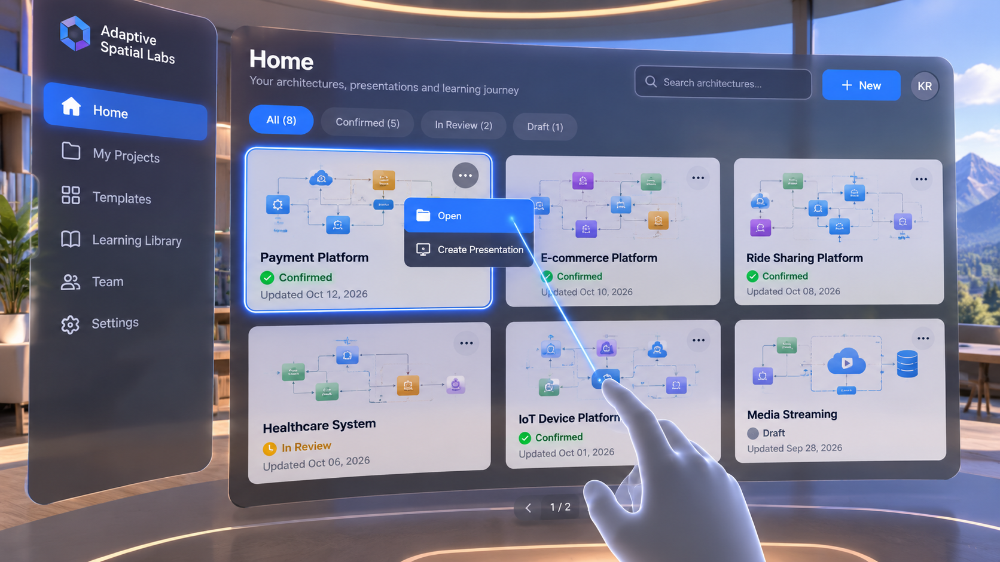
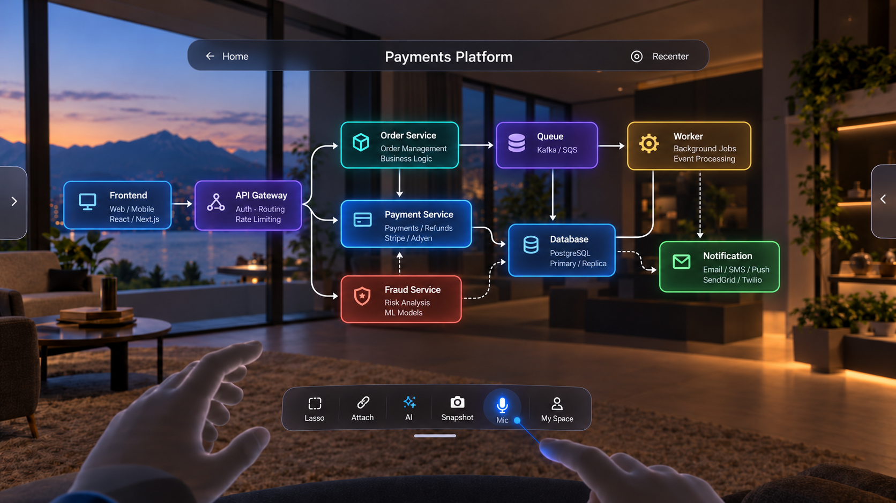
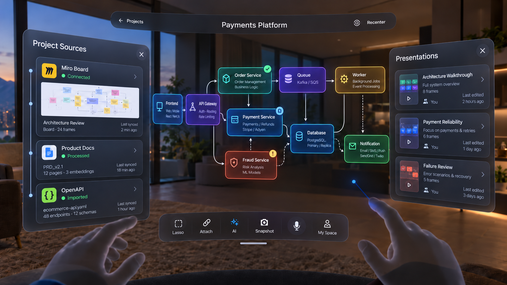

# Adaptive Spatial Labs — Group 4, Stage 1: Home Entry + Open Confirmed Architecture

**Status: Stage 1 product/UX LOCKED — 2026-10-20.**

Documentation/design handoff only. Do not implement Group 4, modify backend/Unity code, redesign Home or the confirmed workspace, or invent navigation. Only two logical screens are defined here: Home card actions and Open confirmed architecture. Three images illustrate those screens and panel states. Presentation setup/creation itself and later Group 4 stages are not defined by this handoff.

## Image-to-screen reference index

| Logical screen/state | Saved reference | Original supplied filename |
| --- | --- | --- |
| Screen 1 — Home, card overflow open | [01-home-card-actions.png](group4-reference-images/01-home-card-actions.png) | home screen confirmation from architecture.png |
| Screen 2 — confirmed architecture, panels collapsed | [02-open-confirmed-architecture.png](group4-reference-images/02-open-confirmed-architecture.png) | open view from the home.png |
| Screen 2 — Sources left and Presentations right open | [03-open-sources-and-presentations.png](group4-reference-images/03-open-sources-and-presentations.png) | open view from the homeleft and right.png |

The original images remain unchanged in the user-created `group4-refrence-images/` folder. The correctly spelled `group4-reference-images/` folder contains byte-identical copies with clear indexed filenames; SHA-256 hashes were checked. Do not treat the third image as an extra screen or new navigation step.

## Screen 1 visual reference

## Screen 2 visual references

## PURPOSE

This stage defines how the user enters the presentation workflow from Home and how a confirmed architecture behaves when opened normally.

This is NOT presentation creation yet.

This stage has two screens only:

## SCREEN 1
Home → architecture card actions

## SCREEN 2
Open confirmed architecture

## SCREEN 1 — HOME

KEEP THE EXISTING HOME STRUCTURE.

Do not redesign the left navigation.

Existing left navigation remains:

Home
Meetings
My Space
Inbox
Settings

Existing top/header behavior remains as already designed.

The main area contains multiple project / architecture cards.

Each architecture card may have an overflow menu:

⋯

For a CONFIRMED architecture, the overflow menu should contain only:

Open
Create Presentation

Do NOT include:

Project Details
Duplicate
Archive
Manage
Edit Architecture
or unrelated actions

This is intentionally minimal.

## CARD STATE LOGIC

## CONFIRMED ARCHITECTURE:

⋯
→ Open
→ Create Presentation

## UNCONFIRMED / IN REVIEW:

Do NOT allow Create Presentation.

Instead, use the existing review continuation behavior.

For example:

Continue Review

The architecture must be confirmed before it becomes eligible for presentation creation.

## HOME INTERACTION

Head gaze may provide a subtle pre-focus / soft highlight for a large architecture card.

Head gaze does NOT activate the card.

Actual action:

hand ray + pinch
or equivalent supported hand interaction

For the overflow menu:

point / target ⋯
→ pinch
→ open contextual menu

Selecting:

Create Presentation

will later enter Group 4 Presentation Setup.

Selecting:

Open

opens the confirmed architecture workspace.

## IMPORTANT HOME RULE

Create Presentation and Open are different.

Open:
inspect / work with the confirmed architecture normally.

Create Presentation:
start presentation preparation.

Do NOT merge these actions.

## SCREEN 2 — OPEN CONFIRMED ARCHITECTURE

When the user selects Open:

DO NOT create a new workspace design.

Reuse the same spatial architecture workspace grammar already established in Group 2.

This is now a CONFIRMED architecture, so Group 2 review/confirmation behavior is removed.

## TOP HEADER

The top header should display the actual architecture/project name.

Example:

← Projects        Payments Platform        Recenter

Do NOT show:

Architecture Review

because this is no longer the review-before-confirmation workflow.

The architecture name should represent the opened architecture.

No profile avatar should suddenly appear in this immersive workspace.

## CENTER

The confirmed architecture remains center-front.

No major redesign from Group 2 spatial layout.

This is the base architecture model.

The user may:

- inspect components
- grab a component for closer inspection
- open documented internal depth where available
- inspect sources/evidence
- use AI
- use Attach
- use Snapshot
- use My Space
- use Lasso as contextual selection if useful

No topology correction happens here.

If architecture editing is required, that remains a separate correction/edit flow.

## LEFT PANEL

The left side MUST remain consistent with Group 2.

Default state:
collapsed left edge tab / arrow.

When opened:

Project Sources

Example content:

Miro Board
Connected

Product Docs
Processed

OpenAPI
Imported

This left panel should look and behave the same as the previously designed Group 2 Project Sources panel.

Do NOT redesign it.

Do NOT change its purpose.

Close:
panel collapses back to the left edge tab.

## RIGHT PANEL

The right panel is intentionally dynamic.

## DEFAULT RIGHT PANEL FOR A CONFIRMED ARCHITECTURE:

Presentations

It should show saved presentations associated with this architecture/project.

Example:

Presentations

Architecture Walkthrough
Full system overview

Payment Reliability
Focus on payments & retries

Failure Review
Error scenarios & recovery

The exact presentation names are examples only.

The right panel is NOT a permanent Questions/Context panel.

## RIGHT PANEL RULE

Default:

Presentations

Temporary contextual replacement:

If the user explicitly chooses Attach / AI / Evidence / another contextual workflow,
the right side can temporarily show that context.

When closed/back:

return to Presentations.

Do NOT permanently stack:

Presentations
Questions
Notes
AI Findings
Evidence

all together.

One right-side purpose at a time.

## BOTTOM TOOLBELT

Keep the familiar toolbelt:

Lasso
Attach
## AI
Snapshot
Mic
My Space

Do NOT redesign this toolbar for the base confirmed architecture.

## LASSO IN THIS SCREEN

Lasso remains available.

In this base architecture workspace:

Lasso means:
select an architecture area as context.

Possible uses:

- inspect attached docs
- inspect notes
- ask AI about the selected area
- save snapshot
- consider the area for later presentation work

Lasso here does NOT automatically create a presentation.

Presentation-specific use of lasso will be defined later in Group 4.

## GRAB / OPEN DEPTH

The user may grab an architecture component and bring it forward for inspection.

When real/documented deeper structure exists:

show known internal depth.

The original architecture should remain visible behind as context.

It may:

- remain slightly farther back
- reduce emphasis
- use subtle tilt/depth separation

Do NOT remove the parent architecture entirely.

If no deeper structure exists:

do not fabricate it.

## HEAD GAZE IN THIS SCREEN

Do NOT use head gaze as a primary architecture selection mechanism.

Use it lightly for large edge controls such as:

left edge tab
right edge tab

Example:

look toward left edge
→ soft highlight
→ pinch
→ Project Sources opens

look toward right edge
→ soft highlight
→ pinch
→ Presentations opens

Head movement alone never opens a panel.

Pinch is still required.

For detailed architecture actions:

direct hand / hand ray / grab may be used depending on the action.

## INTERACTION PRINCIPLE

Large edge control:
head gaze assist + pinch

Precise UI/object:
hand ray + pinch

Near object brought toward user:
direct hand interaction

No automatic action from gaze alone.

## CONFIRMED ARCHITECTURE VS GROUP 2 REVIEW

## GROUP 2 REVIEW:
review reconstructed model
correct if needed
confirm architecture

## OPEN CONFIRMED ARCHITECTURE:
normal architecture inspection/workspace
no confirmation lifecycle
no review state
no correction prompt

Do NOT reintroduce Group 2 confirmation controls here.

## NO NEW LEFT APP NAV INSIDE IMMERSIVE WORKSPACE

The Home app shell left navigation:

Home
Meetings
My Space
Inbox
Settings

must NOT remain permanently visible after entering the immersive architecture workspace.

Instead use the already-established spatial architecture workspace:

left edge tab
center architecture
right edge tab
bottom toolbelt
top header

## REFERENCE IMAGE RULE

Use the supplied images as visual references.

Important:

## HOME IMAGE
= reference for Screen 1.

## OPEN ARCHITECTURE IMAGE
= reference for Screen 2.

If older generated images conflict with this written specification, THIS WRITTEN SPECIFICATION WINS.

Known outdated elements to ignore:

- Project Details in Home menu
- Architecture Review title after Open
- profile avatar in immersive architecture workspace
- permanent Home/Meetings/My Space/Inbox/Settings sidebar inside immersive workspace
- permanent contextual Questions panel on right
- any new shell that differs from Group 2 spatial grammar

## Image differences and written-spec overrides

- The Home image shows Home/My Projects/Templates/Learning Library/Team/Settings. Follow the written existing navigation: Home/Meetings/My Space/Inbox/Settings. The image's learning-oriented subtitle does not add an education feature or authorize a Home redesign.
- The collapsed-workspace image labels the back control Home; the written header uses Projects. Use Projects per this handoff, not a new navigation route inferred from the image.
- The Home card says Payment Platform while the opened examples say Payments Platform. These are illustrative labels; use the actual selected architecture/project name consistently.
- The panels-open image includes status-like badges. Do not infer a new review/confirmation lifecycle for an already confirmed model from decorative/sample badges.
- The two workspace images show legitimate collapsed/open panel states. Presentations is the default right-side purpose when that panel is shown; temporary Attach/AI/Evidence content replaces it, and close/back restores Presentations. This does not require permanently keeping a large right panel open.
- Project Details, Architecture Review as the opened-workspace title, an immersive profile avatar, a permanent Home app sidebar in the immersive workspace, permanent contextual Questions on the right, and redesigned workspace shells are explicitly overridden if encountered in older images.
- Presentation names, frame counts, source sync timestamps, example technologies, and project data are examples, not implementation requirements or proof of real connections.

No blocking contradiction remains for documenting Stage 1: the written rules resolve the listed visual discrepancies. Head-gaze assistance and hand mappings are saved UX intentions, not verified SDK bindings; verify current official Meta tooling before implementation. Gaze alone never opens, activates, confirms, or selects architecture.

## Acceptance and boundaries

Retain hands-first operation, roughly two-foot seated reach, optional standing, clear entry/exit/pause/resume without hidden loss, meaningful short-session work, state/privacy separation, and measured performance. Grab-for-inspection does not modify canonical topology/layout; real depth must remain source-backed and the parent architecture stays visible. No new APIs, runtime logic, automated tests, or device verification are created by this documentation.

Backend code was not modified. Unity application code was not modified. Only Group 4 Stage 1 is documented as locked; later presentation stages remain for future discussion.
