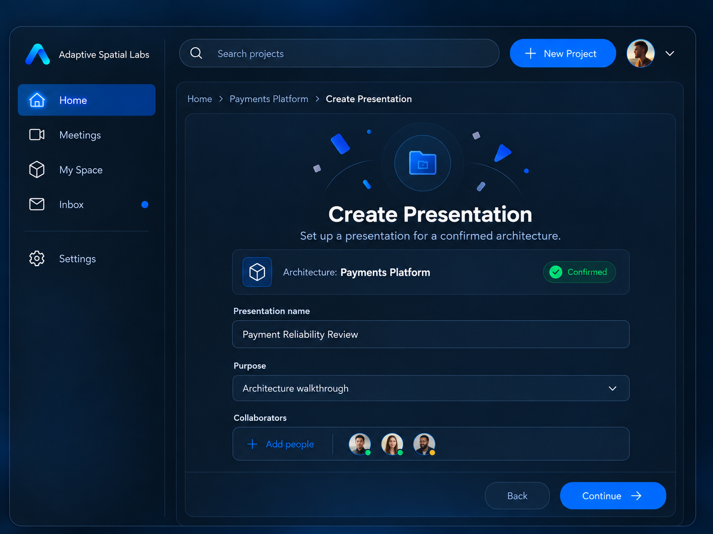

# Adaptive Spatial Labs — Group 4, Stage 2: Presentation Setup

**Status: agreed Stage 2 product/design handoff — 2026-10-20.** Documentation only; not implemented or device-verified. Do not modify backend or Unity application code, redesign the supplied image, or introduce later-stage features.

## Visual reference

Saved reference: [04-stage2-presentation-setup.png](group4-reference-images/04-stage2-presentation-setup.png), copied unchanged from `Neon Blue Presentation Builder Dashboard.png`; SHA-256 verified. This is the Create Presentation route from Home, distinct from Stage 1's Open route. Sample names/people/statuses are illustrative. Top search/New Project/profile elements are retained only insofar as they match the approved app shell; they do not introduce new behavior. Written specification wins over conflicting visuals.

## Shared keyboard placement

Follow [global-spatial-input-rules.md](global-spatial-input-rules.md) for all text fields, including presentation name, Custom purpose, collaborator search where text entry exists, and email. Main form target: 0.8–1.2 m in front of the seated user's head. Temporary system keyboard comfort target: 0.5–0.8 m in the lower-front zone, below the active field. These are user-defined ASL design targets, not verified Meta standards, guaranteed system-keyboard coordinates, or compulsory physical reach distances. Keep the field readable and hand-ray operation available; verify platform placement capabilities before implementation.

## ENTRY

This screen appears only after:

Home
→ confirmed architecture card
→ ⋯
→ Create Presentation

The architecture has already been selected.

Do NOT ask the user to select the architecture again.

Example:

Architecture: Payments Platform
Status: Confirmed

## APP SHELL

This is still a normal app/setup screen.

KEEP the existing left navigation exactly as designed:

Home
Meetings
My Space
Inbox
Settings

Do NOT show immersive architecture left/right edge drawers here.

Do NOT show:

Project Sources
Presentations drawer
Lasso
Attach
## AI
Snapshot
My Space spatial toolbelt

Those belong to the immersive architecture workspace, not this setup form.

## SCREEN PURPOSE

Collect only:

1. Presentation name
2. Purpose
3. Presentation collaborators

Then Continue.

Do NOT add meeting invitees here.

Presentation collaborators and meeting attendees are different concepts.

## PRESENTATION NAME

Text field example:

Payment Reliability Review

Interaction:

hand ray + pinch field
→ text field receives focus
→ Meta Quest / Horizon OS system virtual keyboard opens
→ user types
→ keyboard Done/Enter closes keyboard
→ entered value remains in field

Do NOT build a custom ASL keyboard.

Use the platform/system keyboard where supported.

Voice may later be used as an optional accelerator, but typing must remain available.

## KEYBOARD SPATIAL BEHAVIOR

When the system keyboard appears:

- keep the form visible
- shift/raise the active field if necessary so it is not obscured
- keyboard should appear in a comfortable near-user lower-front area
- do not place it behind the user
- do not cover Continue if avoidable
- user remains seated
- when keyboard closes, form returns to normal layout

The keyboard is temporary system UI.

ASL does not permanently reserve screen space for it.

## PURPOSE

Purpose uses a compact dropdown / picker.

Possible initial options:

Architecture Walkthrough
Technical Review
Reliability Review
Security Review
Migration Discussion
Incident Review
Decision Discussion
Custom

Do NOT make these options create architecture behavior automatically.

Purpose mainly gives presentation context and helps later AI suggestions.

If Custom is selected:
show a short text field.

That text field also uses the Quest system keyboard.

## COLLABORATORS

Collaborators are people who can help prepare/review this presentation.

They are NOT automatically meeting attendees.

The field shows:

+ Add people

Selecting it opens a compact collaborator picker.

## ADD PEOPLE — FIRST VIEW

Show existing known people first where available.

Possible sources:

- existing project members
- organization/team members already known to ASL
- previously invited collaborators

Example:

Add Collaborators

Project Members

Sarah Lin
Backend Engineer

James Park
Platform Architect

Ravi Kumar
## SRE

[ Add by email ]

The user selects people using:

head/target assist where appropriate
+
hand ray + pinch

Selected people get a clear checkmark.

Then:

[Add Selected]

## ADD BY EMAIL

If the person is not already available:

Add by email

opens:

Email address
[ person@company.com ]

Permission
[ Collaborator ▼ ]

Possible V1 permissions:

Collaborator
Viewer

Keep permissions minimal.

## EMAIL KEYBOARD

When Email field receives focus:

use Meta Quest / Horizon OS system virtual keyboard.

Do NOT create a custom keyboard.

Flow:

pinch Email
→ system keyboard appears
→ user enters email
→ Done
→ keyboard closes
→ email remains visible
→ Send Invite

## EMAIL RULE

Do not call this “Gmail”.

Use generic:

Email
Add by email
Send invitation

It should support normal valid email addresses, including company/work email and Gmail.

## INVITATION BEHAVIOR

For V1:

existing ASL user:
→ add/request collaborator access appropriately

new/non-ASL email:
→ create invitation
→ send invitation link through configured email delivery later

Do NOT give the person project-wide authority merely because they were added as a presentation collaborator.

Presentation permission is scoped to the presentation unless separately granted project membership.

## COLLABORATOR CHIPS / AVATARS

After adding people, show compact people chips/avatars in the Collaborators field.

For example:

Sarah
James
Ravi

Each selected person may have:

avatar
name
permission
remove ×

Do NOT turn this into a large people-management page.

## BACK

Back means:

Return to the previous Home/project context.

If nothing meaningful has been entered:
→ return directly.

If meaningful unsaved Presentation Setup data exists:
→ show a small confirmation:

Discard presentation draft?

[Stay]
[Discard]

If autosave-draft is implemented later, Back may preserve the draft.

Do NOT silently create a completed presentation.

## EXIT / CLOSE

Do NOT add an unnecessary large X inside the form if Back already provides the local navigation.

The app already has a known Home/project navigation path.

For this setup screen:

Back = preferred local exit.

If a global application Exit is required by the wider shell, preserve the existing application behavior rather than inventing a new Group 4-specific Exit button.

Do NOT add both Back and X merely for decoration.

## CONTINUE

Continue is enabled when required setup information is valid.

Minimum:

- presentation name exists
- architecture is confirmed

Collaborators can be optional unless later product requirements make them mandatory.

Purpose may have a sensible default.

On Continue:

save/update Presentation Draft

then proceed to the NEXT Group 4 stage:

Discussion Scope / Presentation Content Selection

Do NOT enter a meeting.

Do NOT start presenting.

Do NOT create success/failure scenarios yet.

## HAND INTERACTION

Large setup controls:

hand ray + pinch

Examples:

Presentation name field
Purpose picker
Add people
Back
Continue

If a control is comfortably within direct-touch range, direct poke can be supported, but it must not be required.

No special/custom hand gestures are needed.

## HEAD GAZE

Head gaze is optional targeting assistance only.

It may softly pre-highlight a large field/button the user is facing.

It NEVER:

- selects a person automatically
- submits the form
- sends an invitation
- presses Continue
- activates destructive navigation

Pinch remains the confirmation/action.

## SEATED / COMFORT RULE

All setup interactions must remain comfortably in front of the seated user.

Do not require:

- leaning far forward
- turning behind
- standing
- large reaches

System keyboard should appear in the comfortable lower-front interaction zone.

## REFERENCE IMAGE RULE

Use the supplied Presentation Setup image as the primary visual reference.

Preserve:

- existing left app navigation
- top search/New Project/profile shell if present in the approved Home design
- Create Presentation central form
- confirmed architecture identity
- Presentation name
- Purpose
- Collaborators
- Back
- Continue

The written specification wins if older generated images conflict.

## NON-GOALS

Do NOT add in this stage:

- meeting attendees
- meeting schedule
- meeting owner/host configuration
- lasso
- architecture manipulation
- success scenario
- failure scenario
- AI visual configuration
- source documents
- presentation screen ordering
- Start Meeting
- architecture edit mode

## Consistency and remaining implementation verification

No blocking contradiction in Stage 2 product behavior was found. System keyboard use and its actual placement/control must be verified against the installed Meta/Unity integration before implementation; ASL must not claim it can force an OS-owned keyboard to specific coordinates. If platform placement prevents the global comfort criteria, flag the limitation to the user and adjust the surrounding form rather than silently building a custom keyboard.

Continue saves/updates a presentation draft and goes to Discussion Scope / Presentation Content Selection. It does not finalize a presentation, start presenting, enter a meeting, or send a meeting invitation. Explicit Send Invite is a separate action whose delivery/persistence implementation remains to be defined. Presentation access never automatically becomes project-wide membership or meeting attendance.

Back is the preferred local exit. Empty form returns directly; meaningful unsaved data prompts Stay/Discard unless a later agreed autosave-draft implementation preserves it. No decorative X or new Group 4-specific global Exit is added. Existing global navigation must preserve the shared no-hidden-state-loss principle.

No backend code or Unity application code was modified. No implementation, email delivery, keyboard SDK binding, automated test, or hardware verification was performed for this handoff. Only Stage 2 is covered; the next Group 4 stage remains to be discussed.
