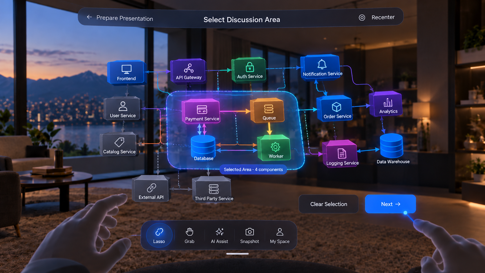

# Adaptive Spatial Labs — Group 4, Stage 3: Presentation Context / Optional Lasso Selection

**Status: user-supplied product/design handoff — 2026-10-20.** Documentation only. Do not implement, modify backend/Unity application code, redesign this screen, or add later-stage controls. This is Stage 3 within Group 4, not a new product group.

## Primary visual reference

Saved as [05-stage3-lasso-selection.png](group4-reference-images/05-stage3-lasso-selection.png), copied unchanged from `Lasso Selection Architecture Workspace.png` and SHA-256 verified. The image shows a selected-area preview; it is not the initial state. Initially the full confirmed architecture is visible and whole architecture is the default context, with Lasso inactive until explicitly selected.

Preserve this immersive spatial composition rather than the Home/setup dashboard. The illustrated selected Payment Service/Queue/Database/Worker and four-component count are examples, not fixed selection rules or project facts. The image's Grab tool is inspection-only: it is not required to define or accept scope. Other illustrated tools do not authorize extra workflows. The exact remaining tool list is not newly finalized by this image; retain established behavior and the written scope below.

Spatial distances and the 5–15 cm focus effect below are user-defined design targets, not verified Meta standards or device test results. They concern rendered placement, not mandatory physical reach. Current Meta hand/ray APIs and actual seated comfort must be verified before implementation. Shared global text-input rules apply if any text entry is introduced in an already authorized workflow; no keyboard form is added to this screen.

## ENTRY

This screen appears after:

Home
→ confirmed architecture
→ Create Presentation
→ Presentation Setup
→ Continue

The user now leaves the flat Home/setup shell and enters the immersive architecture workspace.

This is NOT a Home/dashboard screen.

It should feel visually continuous with Group 2.

## BASE STATE

The full confirmed architecture is visible by default.

Whole architecture is the default presentation context.

The user does NOT need to choose:

Whole Architecture
vs
Lasso

There is no separate scope-selection screen.

Rule:

No lasso selection
→ Next
→ use the whole architecture as the current presentation context.

Lasso selection exists only when the user wants to focus the discussion on a smaller part.

## VISUAL REFERENCE

Follow the supplied image closely.

Keep:

- immersive first-person view
- architecture centered in front of the seated user
- same type of floating architecture blocks
- same connection style
- same warm spatial environment
- same top spatial header style
- same bottom spatial toolbelt style
- visible hands
- architecture floating comfortably in front of the user

Do NOT convert this into a desktop/dashboard layout.

## TOP HEADER

Use the same spatial header grammar as Group 2.

For this presentation-preparation state, the header can indicate the current preparation context.

Example:

← Prepare Presentation        Select Discussion Area        Recenter

Do not turn this into a large wizard/progress header.

Keep the header visually lightweight.

## LEFT / RIGHT SIDE BEHAVIOR

Do NOT permanently open left and right panels.

Preserve the same Group 2 side-edge behavior:

left edge
→ Project Sources available when explicitly opened

right edge
→ contextual/presentation information can appear only when explicitly required

Collapsed by default.

Do not crowd the screen.

The architecture remains the main visual focus.

## BOTTOM TOOLBELT

Keep the familiar spatial toolbelt.

For this step, Lasso must be available.

Do NOT invent a new vertical toolbar.

Use the same bottom floating toolbelt language.

The relevant tools can remain consistent with the architecture workspace.

Lasso is the active tool only when the user explicitly chooses it.

## DEFAULT WHOLE-ARCHITECTURE FLOW

If the user wants the whole architecture:

1. architecture opens
2. user does not activate Lasso
3. user points to Next
4. pinch
5. current full architecture becomes the presentation context
6. continue to the next preparation stage

Do not require another confirmation popup.

## LASSO FLOW

If the user wants a focused discussion area:

1. user targets Lasso in the bottom toolbelt
2. pinch
3. Lasso enters active state
4. user performs pinch-hold while pointing at architecture space
5. move hand/ray around the desired region
6. release pinch
7. system determines enclosed architecture components and relevant connections
8. selected area enters a preview/focus state
9. user chooses:
   - Clear Selection
   - Next

Do NOT use Grab to define lasso scope.

Grab and Lasso have different meanings.

## HAND MOVEMENT

## PRIMARY PRECISE INTERACTION:

hand ray + pinch

Examples:

- select Lasso
- select Next
- select Clear Selection
- activate distant architecture controls

## LASSO GESTURE:

ray target
→ pinch-hold
→ move hand naturally through a small comfortable arc
→ projected lasso path follows the ray intersection on the architecture plane
→ release pinch

The user should NOT need to physically trace a giant circle in the air.

The motion should remain small and seated-friendly.

Do NOT require shoulder-level sweeping gestures.

## RAY BEHAVIOR

The hand ray is used because the architecture is farther than direct-touch distance.

Ray should:

- appear only when useful / targeting
- originate naturally from the pointing hand
- intersect the architecture working plane
- provide clear hover feedback
- update continuously during pinch-hold lasso motion

When ray hovers over:

Lasso
Next
Clear Selection
edge controls

show subtle hover/preselection feedback.

Actual activation still requires pinch.

## LASSO SELECTION VISUAL

During pinch-hold:

show a subtle lasso boundary / selection trace.

After release:

selected components should:

- remain at their original topology positions
- become more visually prominent
- move slightly forward toward the user OR receive a subtle focus-depth effect
- remain connected correctly
- stay readable as a group

Non-selected architecture:

- remains visible
- is slightly dimmed / reduced emphasis
- still provides spatial context

Do NOT hide the rest of the architecture automatically.

Do NOT restructure the architecture.

Do NOT modify canonical topology.

## NO GRAB BEFORE NEXT

Do NOT require the user to grab the lasso-selected group before proceeding.

Lasso itself defines presentation context.

After lasso release:

the system automatically provides a subtle focus preview.

Then:

Next
→ accepts the selected region as the current presentation context.

Grab remains reserved for inspection behavior.

## SELECTED AREA PREVIEW

The image can show a compact indication such as:

Selected Area · 4 components

Example selected area:

Payment Service
Queue
Database
Worker

This is only a preview of the current presentation context.

It is NOT a new architecture.

It is NOT copied data.

It is a reference to existing canonical node IDs and connection IDs.

## NEXT

Next serves as the confirmation for this presentation context.

No separate confirmation popup is needed.

Behavior:

No lasso selection:
→ Next uses whole architecture.

Active lasso selection:
→ Next uses selected architecture region.

Then proceed to the next Group 4 preparation stage.

Do NOT start a meeting.

Do NOT finalize the entire presentation here.

## CLEAR SELECTION

Clear Selection:

- removes current lasso scope
- restores full architecture emphasis
- returns to whole-architecture default
- does NOT delete or edit architecture
- does NOT affect source data

## HEAD GAZE

Head gaze is only soft target assistance.

It may softly highlight:

- left/right edge tabs
- Lasso
- Next
- Clear Selection

It does NOT:

- activate lasso
- complete selection
- press Next
- change presentation scope

Pinch remains required.

## DISTANCE / SPATIAL PLACEMENT

Design for seated Meta Quest use.

Approximate spatial placement:

Architecture working plane:
~0.9 m to 1.3 m in front of user

Main central architecture focus:
around ~1.0 m to 1.2 m

Top header:
slightly above architecture center
within comfortable upward gaze
not near ceiling height

Bottom toolbelt:
~0.5 m to 0.8 m from user
lower-front / chest-to-lap zone

Next / Clear Selection:
~0.7 m to 1.0 m
comfortable lower-right/front zone
within easy ray targeting

Left/right collapsed edge tabs:
kept within comfortable forward peripheral FoV
not behind the user

The user must remain seated.

No interaction should require reaching outside roughly a 2-foot comfortable interaction radius.

## FOCUS DEPTH AFTER LASSO

After selection:

selected area may come slightly forward by approximately 5–15 cm equivalent visual depth.

This is only a presentation preview effect.

Do NOT physically detach the selected nodes from topology.

Do NOT alter their saved architecture coordinates.

The base architecture remains behind in context.

## SOURCE / DOCUMENT BEHAVIOR

Documents remain attached to canonical architecture objects.

Lasso does not duplicate documents.

The selected presentation context stores references to:

- selected node IDs
- selected connection IDs
- source/evidence references
- relevant notes/questions/findings

Source details do NOT need to be shown automatically on this screen.

They may be accessed later through contextual tools.

## DO NOT ADD

Do NOT add:

- Home sidebar
- Search bar
- New Project
- profile avatar/header
- wizard progress steps
- Presentation Screens panel
- success/failure screen thumbnails
- giant contextual inspector
- desktop-style side navigation
- architecture editing controls
- Group 2 Confirm Architecture button
- meeting attendees
- meeting controls

## INTERACTION SUMMARY

Whole architecture path:

Continue from Setup
→ architecture opens
→ Next
→ use whole architecture

Focused path:

Continue from Setup
→ architecture opens
→ Lasso
→ ray + pinch-hold
→ small hand movement traces selection
→ release
→ selected area subtly focuses
→ Next
→ use selected area

## DATA MODEL INTENT

Do not create a duplicate architecture for lasso selection.

Store presentation context as references.

Conceptually:

PresentationContext
- architectureId
- architectureVersion
- selectedNodeIds[]
- selectedConnectionIds[]
- scopeType: WHOLE | LASSO
- evidenceRefs[]
- noteRefs[]
- questionRefs[]
- aiFindingRefs[]

If scopeType = WHOLE:
selected lists may be empty or resolved to whole architecture according to implementation design.

## Handoff consistency and acceptance

No blocking product contradiction was found. “Original positions” refers to canonical/topological layout: any forward preview is a temporary presentation render effect only, with saved coordinates and relationships intact. Connection rendering must remain understandable as focus depth changes. Non-selected architecture stays visible; detail reduction does not authorize automatic removal of the rest of the model on this screen.

Next accepts WHOLE or LASSO context without an extra popup. It does not confirm canonical architecture again, finalize the presentation, start presenting, or enter a meeting. No lasso is required, and no separate Whole-versus-Lasso scope screen is introduced. Clear Selection restores the whole-architecture default without editing sources or nodes.

The conceptual PresentationContext is documentation only, not a finalized database schema/API. Referencing notes, questions, findings and evidence does not grant new access or automatically publish private content; preserve existing privacy/visibility rules and user authorization. Architecture data/documents are not duplicated by context selection.

Retain hands-only completion, small comfortable seated arcs, optional standing, forward FoV, clear Back/Recenter/Next controls, pause/resume preservation, short-session value, and future measured performance/device checks. The visible Prepare Presentation back control retains existing draft/no-hidden-loss expectations; no additional navigation or discard policy is invented here.

Only documentation and an image copy were added. Backend code and Unity application code were not modified. No runtime implementation, automated tests, or device verification were performed.
