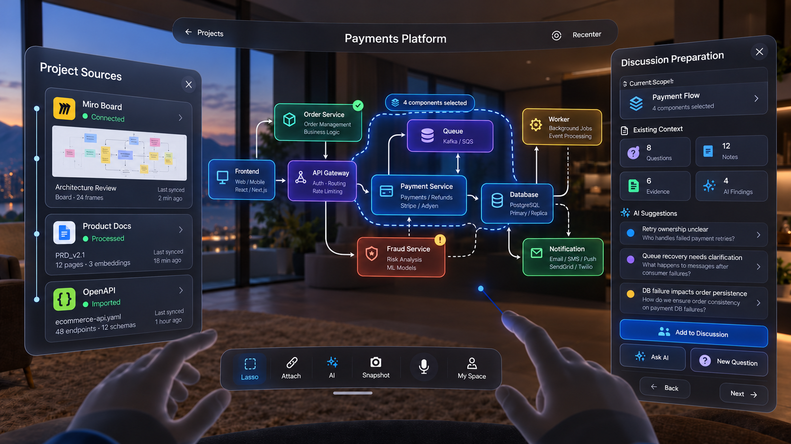

# Adaptive Spatial Labs — Group 4, Stage 4: Discussion Preparation

**Status: user-supplied product/design handoff — 2026-10-20.** Documentation only; no backend or Unity implementation authorized. This is Stage 4 within Group 4, not the Group 6 live-discussion lifecycle.

## Primary visual reference

Saved as [06-stage4-discussion-preparation.png](group4-reference-images/06-stage4-discussion-preparation.png), copied unchanged from `Mixed Reality Payment Architecture Review.png`, with SHA-256 verification. This current image is authoritative for visual composition over older generated references. Written action/state/selection rules remain explicit requirements; visual sample data does not silently redefine them.

The supplied image labels four selected components but its boundary and visible nodes do not unambiguously match the example Payment Service/Queue/Database/Worker set. Treat this as an illustration discrepancy: actual boundaries, count, highlight and scope references must agree in implementation. No fixed four-component set is required. Sample AI risks, source statuses, counts and technologies are illustrative, not verified findings or live data. No redesign or image editing was performed.

## ENTRY

This screen appears after:

Home
→ confirmed architecture
→ Create Presentation
→ Presentation Setup
→ Continue
→ whole architecture or optional Lasso selection
→ Next

The user is already inside the immersive architecture workspace.

Do NOT return to the Home/dashboard shell.

## PURPOSE

The purpose of this screen is:

"Prepare what should actually be discussed for this presentation context."

The current context may be:

1. whole architecture
or
2. a lasso-selected architecture area

The architecture itself remains canonical.

This stage does not edit architecture truth.

## VISUAL LAYOUT

Use the supplied image exactly as the main visual reference.

Spatial structure:

## LEFT
Project Sources

## CENTER
Architecture / current selected scope

## RIGHT
Discussion Preparation

## BOTTOM
existing architecture toolbelt

## TOP
same spatial workspace header grammar

Do NOT invent a new layout.

## LEFT SIDE — PROJECT SOURCES

Keep exactly the same Project Sources concept already established in Group 2.

Examples:

Miro Board
Connected

Product Docs
Processed

OpenAPI
Imported

Purpose:

show source provenance and imported project material.

This is the stable left-side responsibility.

Do NOT replace the left panel with presentation controls.

The left panel can be collapsed/opened using the existing spatial behavior.

## CENTER — ARCHITECTURE

Keep the confirmed architecture in the center.

If the previous step used Lasso:

- selected components remain visually emphasized
- show the selected area boundary/focus
- rest of architecture remains visible as context
- topology remains unchanged

Example:

Payment Service
Queue
Database
Worker

Selected Area:
Payment Flow

If no lasso was used:

the whole architecture is the active context.

## RIGHT SIDE — DISCUSSION PREPARATION

The right panel is the working panel for this stage.

Title:

Discussion Preparation

It should contain:

1. Current Scope
2. Existing Context
3. AI Suggestions
4. actions
5. Back
6. Next

## CURRENT SCOPE

Show which architecture context is currently being prepared.

Example:

Current Scope

Payment Flow
4 components selected

If whole architecture is active:

Current Scope
Whole Architecture

This is informational only.

## EXISTING CONTEXT

Show counts / access to existing context attached to the current architecture scope.

Categories:

Questions
Notes
Evidence
AI Findings

Example:

8 Questions
12 Notes
6 Evidence
4 AI Findings

These are NOT copies.

They are references to canonical information already attached to architecture nodes, connections, lasso contexts, or architecture-wide context.

## EXISTING CONTEXT BEHAVIOR

Selecting one category can open/filter the corresponding relevant items.

Example:

Questions
→ show questions relevant to current selected scope

Evidence
→ show evidence/source references relevant to current selected scope

AI Findings
→ show previously saved AI findings

Notes
→ show saved human notes

Do NOT show every project item.

Only contextually relevant items should appear.

## AI SUGGESTIONS

AI can suggest possible discussion points based on:

- selected architecture context
- imported docs
- notes
- questions
- evidence
- AI findings
- known architecture relationships

Examples:

Retry ownership unclear

Queue recovery needs clarification

DB failure impacts order persistence

AI suggestions are advisory only.

Nothing is added to the presentation automatically.

## AI SAFETY / PRODUCT RULE

AI must not invent architecture facts.

AI suggestions should be grounded in:

- canonical architecture
- source documents
- explicit user assumptions
- already stored context

If something is uncertain, mark it as uncertain or suggested for discussion.

## ADD TO DISCUSSION

Action:

Add to Discussion

Purpose:

take the currently selected existing context item or AI suggestion and include it in the current presentation discussion.

This creates a presentation reference.

It does NOT duplicate or move the original canonical note/question/evidence item.

Conceptually:

PresentationDiscussionItem
- sourceRef
- architectureContextRef
- displayOrder
- presentationScreenId

## ASK AI

Ask AI opens the existing contextual AI experience.

It may use the current selected scope automatically as context.

Example:

Current Context:
Payment Flow

Question:
"What happens if the payment succeeds but order persistence fails?"

AI returns grounded reasoning.

User may then explicitly choose to save/add a useful finding.

Do NOT automatically add AI responses into the presentation.

## NEW QUESTION

New Question allows the architect to create a new question attached to the current architecture scope.

Example:

"Who owns retry handling after payment succeeds?"

The question should be saved to canonical project knowledge with architecture context.

Then it may also be added to this presentation if the user chooses.

Do NOT make presentation-only orphan questions unless explicitly designed later.

## RIGHT PANEL DYNAMIC RULE

The right side has one active purpose at a time.

Default for this stage:

Discussion Preparation

If user presses AI:

right panel may temporarily become Context AI.

If user opens Evidence:

right panel may temporarily become Evidence.

Close / Back from temporary context:

return to Discussion Preparation.

Do NOT stack:

Discussion Preparation
Context AI
Evidence
Questions

simultaneously.

## BOTTOM TOOLBELT

Keep the familiar toolbelt.

Example:

Lasso
Attach
## AI
Snapshot
Mic
My Space

Do NOT redesign it.

The tools retain their existing semantics.

## LASSO IN THIS STAGE

Lasso remains available if the architect wants to change/refine the discussion scope.

If lasso changes:

- update Current Scope
- refilter Existing Context
- refresh AI suggestions
- do not silently remove already-added discussion items without confirmation

Do NOT modify architecture topology.

## HAND / RAY INTERACTION

Use:

hand ray + pinch

for:

- selecting a context card
- choosing AI suggestion
- Add to Discussion
- Ask AI
- New Question
- Back
- Next
- side-panel controls

Direct poke may be supported for near controls but is not required.

## HEAD GAZE

Head gaze is only target assistance.

It may softly highlight:

- left/right side tabs
- large buttons
- selectable cards

It must never:

- add discussion items
- activate AI
- press Next
- create questions

Pinch confirms every action.

## SPATIAL DISTANCE

Keep the spatial arrangement consistent with previous architecture screens.

Approximate:

Center architecture:
~1.0–1.2 m in front

Left Project Sources:
~0.9–1.2 m, slightly left-front

Right Discussion Preparation:
~0.9–1.2 m, slightly right-front

Bottom toolbelt:
~0.5–0.8 m, lower-front

All content must stay inside comfortable seated FoV.

No interaction behind the user.

## BACK

Back returns to the previous Group 4 context-selection state.

Preserve:

- current architecture
- lasso selection
- current draft presentation
- already chosen presentation context where appropriate

Do NOT return directly to Home unless the user explicitly exits preparation.

## NEXT

Next means:

"Discussion preparation for this current presentation screen is sufficient."

Next should:

- save current presentation-screen discussion references
- preserve the chosen architecture scope
- preserve selected discussion items
- proceed to the next Group 4 screen-building stage

The next stage is:

Success / Normal Flow screen preparation

Do NOT start a meeting.

Do NOT finalize the presentation.

## DATA MODEL INTENT

Do not duplicate canonical architecture or project knowledge.

Conceptually:

PresentationScreen
- architectureId
- architectureVersion
- scopeType
- selectedNodeIds[]
- selectedConnectionIds[]
- discussionItemRefs[]
- evidenceRefs[]
- noteRefs[]
- questionRefs[]
- aiFindingRefs[]
- visualConfiguration
- screenOrder

Canonical items remain stored in project knowledge.

Presentation stores references to those items.

## NON-GOALS

Do NOT add:

- Home sidebar
- dashboard layout
- project card grid
- presentation thumbnails
- meeting invitees
- meeting controls
- architecture correction tools
- Group 2 Confirm button
- giant inspector
- automatic AI decisions
- automatic content insertion
- duplicate project documents

## VISUAL AUTHORITY

The supplied image is the visual authority.

Preserve:

- left Project Sources
- center architecture
- lasso-selected Payment Flow context
- right Discussion Preparation panel
- bottom toolbelt
- top spatial header
- visible Quest hands
- warm immersive environment
- ray interaction

If older generated images conflict, this current reference image wins.

## Detailed hand movement — user clarification

Use small, precise seated movements. Hand ray + pinch is primary; the hand stays mainly chest-to-lap, with only a natural lift when targeting. Do not require sustained raised arms, large shoulder movement, full-arm sweeps, standing, reaching behind, giant circles, swipe navigation or special gesture shortcuts.

| Action | Hand sequence | Feedback / outcome |
| --- | --- | --- |
| Open/select right-panel item | point → ray hover → soft highlight → one pinch | Open/select Questions, Notes, Evidence, AI Findings, or an AI suggestion |
| Add to Discussion | hover → pinch item → point at Add to Discussion → pinch | Small “Added to Discussion ✓” feedback; no dragging cards or physically transferring them into architecture |
| Ask AI | point → hover → pinch | Right panel temporarily becomes Context AI; select mic + pinch to speak, or text field + pinch for system keyboard |
| New Question | point → pinch | Compact input; field + pinch for system keyboard, or mic + pinch for voice; no custom gesture |
| Stage Back / Next | ray point → hover highlight → pinch | Explicit navigation only; no automatic forward transition or swipe |
| Open Sources | look/point toward collapsed left tab → soft highlight → pinch | Sources opens; ray + pinch accesses source items; X/collapse + pinch closes it |
| Temporary right context Back/X | point → pinch | Context AI/Evidence closes back to Discussion Preparation within Group 4, rather than leaving the stage |
| Change lasso scope | choose Lasso + pinch → pinch-hold on architecture plane → small arc → release | Update scope/context/suggestions, preserving already-added discussion items unless removal is confirmed |
| Head-gaze assist | face a large control/tab/card | Soft pre-highlight only; never activation. Pinch confirms Back/Next/Add and all other actions |

Use [global-spatial-input-rules.md](global-spatial-input-rules.md) for any input: platform/system keyboard rather than custom ASL keyboard, active field visible, hands-only typing available, optional voice. Architecture 1.0–1.2 m; side panels 0.9–1.2 m; lower-front toolbelt 0.5–0.8 m are user-defined visual placement targets, not required reach distances or verified Meta SDK constraints. Retain roughly two-foot seated physical actions and verify actual platform behavior/comfort before implementation.

## Navigation, privacy and consistency qualifications

The stage's Back returns to Stage 3 context selection with draft/scope intact. Back/X within a temporary Context AI/Evidence purpose returns to Discussion Preparation. Collapsing the main right panel does not implicitly advance or exit Group 4; no additional close-navigation policy is invented. Next saves discussion references and scope, then goes to Success / Normal Flow screen preparation; it neither starts a meeting nor finalizes the presentation.

AI suggestions remain advisory until explicitly selected/added. User-created questions are saved as scoped project knowledge, separately from optional inclusion in a presentation. Existing references do not create duplicate notes/docs or widen access. Canonical project knowledge is distinct from canonical architecture topology: a new question can enrich knowledge without changing architecture truth. Private material is never automatically made project-visible or sent to AI merely because relevant; retain existing explicit sharing, permission and provider-disclosure rules.

The conceptual data shapes above are design intent, not finalized API/database contracts. No blocking behavior contradiction was found; the image's selection illustration discrepancy is recorded rather than used to invent a selection rule. Retain global entry/exit/pause/resume, short-use, comfort and measured-performance gates. No automated or device testing is claimed for this documentation.

## Change boundary

Only this stage's design documentation, image reference and consolidated discussion summary were updated. Backend code was not modified. Unity application code was not modified. No future Success / Normal Flow stage has been designed or implemented by this handoff.
